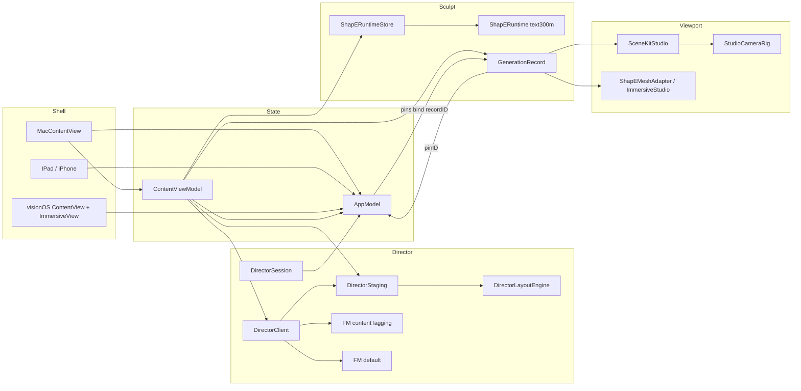

# Mesquette knowledge graph

**For agents.** Read this before changing Director, pins, layout, Shap-E loading, or export.  
**Product name:** Mesquette (`AppIdentity.name`). Xcode project/folder is `Mesquette`.  
**Bundle id:** `com.visionarydevops.Mesquette`  
**Generated:** 2026-11-17  
**Machine copy:** [`knowledge-graph.json`](knowledge-graph.json)  
**Keep in sync:** any Swift change in this repo must update this file and the JSON in the same turn. `scripts/check-knowledge-graph.sh` enforces it.

This graph describes the **current working tree on `feature/visionOS`**, including uncommitted Director/pin work.

---

## 1. What this repo is

On-device **3D ideation shell**: user describes a scene (or drops a photo) → Apple Foundation Models optionally split the scene → **Shap-E `text300m`** (MLX) sculpts one closed mesh per prompt → SceneKit / RealityKit shows it on a table.

| Layer | Owns | Does not own |
|---|---|---|
| Pins + code | Where meshes sit (x, y, z), empty vs filled | Mesh pose / Euler rest |
| Foundation Models | Named objects, floor vs air, leftover extras | Coordinates, Shap-E quality |
| Shap-E | Geometry + vertex colors | Scene layout |
| Viewport | Camera, drag, pin clicks | Generation |

**Mac is the primary UI.** iPad / iPhone / visionOS share `AppModel` + `ContentViewModel`.

---

## 2. Hard invariants (do not violate)

1. **Pins are a spatial queue.** Generate fills **empty** pins only. Retry = same prompt + new seed. Do not re-plan a retry.
2. **Do not pose meshes.** No LLM Euler, no lock-and-rotate, no `MeshSitter` (deleted). Plant at the pin; keep Shap-E rotation. Pin `y` is height (floor vs airborne).
3. **Do not rewrite the user's English.** Poison-only strip (`cad`, `8K`, `photorealistic`, `highly detailed`). No 24-word clip, no junk-phrase rewrite.
4. **Do not dump the whole scene into every Shap-E prompt.** Named objects get their own sentence. Never fall back to the full brief for a missing extra.
5. **Do not auto-fill leftover pins.** Extra props are a **slider 0…leftover**. Default 0. Invalid extras are skipped, not replaced with “complementary closed prop.”
6. **Placement is keyed by `pinID`.** `packRecords` must not map record *i* → pin *i* when `record.pinID` is set.
7. **Trust structured height.** Tagging `floor`/`airborne` wins over `looksAirborne` heuristics.
8. **Object identity is not the last word of the title.** Full normalized phrase + inventory UUID. “Red sports car” and “blue sports car” are two objects.
9. **Ground is never a mesh.** Sea/grass/road/sky/weather stay the studio floor. An explicitly named forest/meadow **patch** is one closed mound; pin refit **does not** expand `fillsToNeighbors`.
10. **Two Foundation Models, two jobs.** `.contentTagging` → named objects + height. `SystemLanguageModel.default` → leftover extras only. Compile (`DirectorSystemPrompt.text`) is a **separate** entry point (no pins).
11. **No agent loop until-complete.** No LLM vision-evaluate of meshes. One Shap-E run per job; skip or fail visibly.
12. **Failed Shap-E loads must retry.** Do not cache a thrown `loadTask`.
13. **Pin ownership is two-sided.** Unbind only if that pin still belongs to the record being removed.
14. **TripoSR is image-only.** The model picker forces image input; text prompts, Compile, and pin scenes always run on Shap-E. TripoSR single-image generation goes through the `RuntimeWrapper` facade (`ThreeDGenerationRuntime`, `.tripoSR(weightsURL:)`) and must be fed `ImageBackgroundRemoval.foregroundCutout` (alpha crop + 0.85 square pad) — never the white Shap-E composite, which TripoSR meshes as a slab. Vision masks are Float32 (`L00f`) on current OSes.

---

## 3. Repo map

```
Mesquette/                 Swift app (Mesquette)
  AppModel.swift               Shared state
  ContentViewViewModel.swift   Generate / pin plan / Shap-E jobs
  Director/                    Foundation Models + pin assignment + layout
  macOS/                       Primary viewport (SceneKit + StudioCamera)
  iOS/  visionOS/              Other shells
  ShapERuntimeStore.swift      Actor: load Shap-E off main actor
  RuntimeAssetLocator.swift    Resolution order: bundled → Background Assets → HF cache
  HFBundleDownloader.swift     Pinned HF snapshot download + SHA-256 verify (fallback)
  TripoSRStore.swift           Actor: TripoSR facade runtime from verified weights
  MeshExporter.swift           OBJ+MTL ZIP, USDZ, face-index validation
AssetDownloader/               StoreDownloaderExtension (hosted weights)
AssetPacks/                    shap-e-text (essential), shap-e-image (prefetch)
runtime_bundle/                NOT a build input anymore. Asset-pack packaging workspace only (scripts/fetch-weights.sh), gitignored
Packages/RealityKitContent     visionOS table scene
MesquetteTests/            unit tests (macOS + visionOS; run on macOS)
Vendor/apple-mlx-foundations/    git submodule (signalnotnoise/apple-mlx-foundations) pinned `3de8228` (post-v0.1.0 main); shap_e/swift = local package ShapERuntime
```

External packages: `mlx-swift` 0.31.3 (GitHub), `swift-transformers` Hub ≥1.4.0 (GitHub, HF weights download), `RuntimeWrapper` + `TripoSRRuntime` (foundations submodule; TripoSR image backend via `ThreeDGenerationRuntime`), `ShapERuntime` (local `Vendor/apple-mlx-foundations/shap_e/swift`, submodule pinned to foundations `3de8228`). Never point the Xcode project at the sibling `../apple-mlx-foundations` checkout — that is the private pre-publication archive, not the public dependency.

---

## 4. Module graph



---

## 5. Generate-at-pins flow (live path)

This is **not** Compile. Compile uses `DirectorSystemPrompt.text` and template slots. Pins skip compile.

```mermaid
sequenceDiagram
  actor User
  participant UI as MacChatPanel
  participant VM as ContentViewModel
  participant Tag as contentTagging
  participant Code as DirectorStaging
  participant Ex as default extras
  participant SE as Shap-E

  User->>UI: drop pins, paste scene, Extra props 0…N
  User->>UI: Generate empty pins
  UI->>VM: generateAtPins
  VM->>Tag: tagSceneCast (25s)
  Tag-->>Code: TaggedSceneCast or nil
  Code->>Code: resolvedCast + namedPinJobs by height
  Note over Code: leftover extraPins
  alt extras budget > 0
    VM->>Ex: planPins mode extras, pinIndex map
    Ex-->>VM: valid named objects only
  else budget 0 or extras fail
    Note over VM: leftover pins stay empty
  end
  loop each PinAssignment
    VM->>SE: one prompt, seed, plant at pin xyz
    SE-->>VM: MeshResult
    VM->>VM: bindPin both sides, packRecords by pinID
  end
  VM-->>UI: pinPlanNote e.g. 6 generated; 15 empty
```

**Job routes** (`PinPlanRoute`, logged per job): `named` | `extra` | `fallback`.

**Slider max** = leftover empty pins after a **code** named cast (`AppModel.extraPropsCapacity`). Yorkshire + 21 empty pins → **0…15**.

---

## 6. Compile flow (no pins)

```
prompt → DirectorClient.compile (default FM + DirectorSystemPrompt.text)
      → CompiledPrompt.normalized() (cap 6 parts, drop ground-like)
      → DirectorLayoutEngine.applyTemplate / applyPins
      → generateMeshSet → sequential Shap-E
```

Do not silently treat this as the pin path. Rewriting only `DirectorSystemPrompt.text` misses Generate-at-pins.

---

## 7. Core types

| Type | File | Role |
|---|---|---|
| `AppModel` | `AppModel.swift` | Prompt, pins, history, extras budget, pinPlanNote |
| `PlacementPin` | `Director/PlacementPin.swift` | Clicked (x,y,z). `y ≥ 0.15` = airborne. Max 100. `recordID` |
| `PinAssignment` | `Director/PinAssignment.swift` | One Shap-E job: pinID, prompt, scale, `inventoryID`, `route` |
| `SceneObject` | `Director/DirectorStaging.swift` | Named cast entry: UUID, sourcePhrase, title, height |
| `GenerationRecord` | `GenerationRecord.swift` | History row: mesh, `pinID`, `inventoryID`, `planRoute`, offsets |
| `CompiledPrompt` | `Director/CompiledPrompt.swift` | Compile output (kind single/set, parts, layout) |
| `DirectorStamp` | `Director/DirectorSession.swift` | Metadata on a generation; **only if prompt matches compilation** |
| `StudioCameraRig` | `macOS/StudioCamera.swift` | Orbit / top / walk. Not SceneKit arcball |

**Pin fill:** empty | busy (in-flight while `isGenerating`) | filled (completed + mesh). Failed records do not fill a pin.

**Ownership:** `bindPin` / `unbindPin(belongingTo:)` update pin.recordID **and** record.pinID. `removeGeneration` unbinds only if the pin still points at that record.

---

## 8. Director file ownership

| File | Job |
|---|---|
| `DirectorClient.swift` | FM sessions. `tagSceneCast`, `planPins`, `compile`, `invent`. `assignmentsMatchingPinIndex` |
| `DirectorStaging.swift` | Code cast, identity, prompt validation, namedPinJobs, atmosphere/scale heuristics |
| `DirectorLayoutEngine.swift` | Slots → meters, fit AABB, `packRecords` by pinID |
| `DirectorGenerable.swift` | `@Generable` schemas + mapping into staging types |
| `DirectorSystemPrompt.swift` | `text` (compile), `inventText`, `contentTagText`, `pinPlanText`, `scenePinPlanText` |
| `DirectorSession.swift` | apply/revert/stamp onto AppModel |
| `PlacementDebug.swift` | `os.Logger` (category `place`, prompt fragments `.private`) for pin jobs |

---

## 9. Sculpt / assets / export

| Piece | Detail |
|---|---|
| Weights | Shap-E **text300m** + CLIP ViT-L/14 77 tokens. Image pipeline (`clip_vision`, `image300m`) on first image generate |
| Debug | No weights in the app (88 MB). First launch: `HFBundleDownloader` snapshot-downloads HF `signalNotNoise/shap-e-mlx` @ `d71f70a` (v0.1.0) into `Caches/huggingface`, SHA-256 verified + stamped for offline reuse. `scripts/fetch-weights.sh` remains only to stage `runtime_bundle/` for asset-pack packaging |
| Release | Background Assets: `shap-e-text` essential, `shap-e-image` prefetch; HF fallback if packs unavailable. Never touch Background Assets without a team ID — `AssetPackManager` traps (does not throw) in ad-hoc builds; `RuntimeAssetLocator.hasTeamIdentifier` gates it (macOS: SecCode signing info; iOS/visionOS: embedded provisioning profile, since SecCode is macOS-only) |
| Load | `ShapERuntimeStore` actor. Failed `loadTask` is cleared (`loadEpoch`) so Generate can retry |
| GPU | `MLXForegroundGPU` binds Metal on main after the app is active |
| Preview | `RuntimeLaunchContext.isXcodePreview` skips MLX (PreviewShell abort) |
| Export | USDZ as-is. OBJ writes `.obj`+`.mtl`, share/save a **ZIP** of both |
| Indices | `MeshExporter.validatedFaceIndices` shared with `ShapEMeshAdapter` (visionOS). No trapping `UInt32(v)` |
| Logging | `os.Logger` only (categories: `place`, `image`, `generate`, `mesh-adapter`, `immersive`); no `print` in app sources, prompt fragments `.private` |

Shap-E blobs are a **model prior** problem, not a Director bug, once prompts actually name the object.

---

## 10. Viewport

| Platform | Renderer | Notes |
|---|---|---|
| macOS | SceneKit (`Mac3DPreviewView`, `SceneKitStudio` incl. shared `makeGeometry`) | Pin click/drag; tumble orbit (look down); walk first-person; shading modes |
| iPad / iPhone | SceneKit | Phone: full-canvas + bottom sheet |
| visionOS | RealityKit (`ImmersiveStudio`, `ShapEMeshAdapter`) | Glass table ~1.25 m forward, 0.72 m high. Vertex colors baked per triangle |

Table axes: **+X right, +Z toward the user**, Y up. Pin Y is height above the table.

---

## 11. Tests and how to verify

Test target runs on macOS via the shared scheme (`SUPPORTED_PLATFORMS = macosx xros xrsimulator`): `xcodebuild test -scheme Mesquette -destination 'platform=macOS,arch=arm64'` (101 tests). visionOS build-for-testing also compiles. **Verified compile path:**

```
DEVELOPER_DIR=/Applications/Xcode-beta.app/Contents/Developer \
  xcodebuild -scheme Mesquette -destination 'platform=macOS,arch=arm64' build
```

| Test file | Covers |
|---|---|
| `PinFillTests` | Bind/unbind, Yorkshire cast, 6 vs 21 leftover, identity, lantern height, amber bottle, pinIndex extras, extras slider max 15 |
| `HFBundleDownloaderTests` | Pinned revisions (Shap-E + TripoSR), scope globs, checksum parse/filter, fail-closed verify, model picker forces image for TripoSR |
| `ImageBackgroundRemovalTests` | TripoSR foreground prep: alpha bounds, square-canvas 0.85 ratio |
| `DirectorLayoutEngineTests` | `packRecords` by pinID, locked pins, fills expand (non-pin path only) |
| `DirectorSessionTests` | stamp does not leak scale/material onto unmatched prompts |
| `DirectorSplitPolicyTests` | prompts: no posing, height split, fills never grow on pins |
| `MeshExporterTests` | face index validation, OBJ+MTL ZIP |
| `StudioCameraTests` | orbit pitch, walk |
| `DirectorCompiledPromptTests` | normalize, drop cobbles, 6-cap |

Do **not** add mesh-quality CI. Planner fixtures (titles, pinIDs, prompts) only.

---

## 12. Product decisions other agents often reverse

| Temptation | Actual decision |
|---|---|
| Unify Compile and Pins into one service | Keep two entry points; share inventory types only |
| Hardcoded forge wardrobe as extras fallback | Skip the pin |
| Second FM “repair” of bad extras | Skip the pin; show `pinPlanNote` |
| LLM rest pose / sit | Deleted `MeshSitter` |
| Arcball camera | Custom tumble + walk |
| Hunyuan3D / swap CLIP embeddings | Stay on text300m; TripoSR exists in foundations, not wired |
| Image Playground as silent Apple image gen | User sheet on OS 27; `ImageCreator` is dead |
| Phrase-existence tests as prompt quality | Fixtures for duplicate cars, grounded lantern, amber bottle, 21 pins |

---

## 13. Node index (files agents touch most)

```
AppModel.swift
ContentViewViewModel.swift
Director/DirectorStaging.swift
Director/DirectorClient.swift
Director/DirectorLayoutEngine.swift
Director/DirectorGenerable.swift
Director/DirectorSystemPrompt.swift
Director/DirectorSession.swift
Director/PinAssignment.swift
Director/PlacementPin.swift
GenerationRecord.swift
ShapERuntimeStore.swift
MeshExporter.swift
ShapEMeshAdapter.swift
macOS/MacContentView.swift
macOS/MacChatPanelView.swift
macOS/Mac3DPreviewView.swift
macOS/SceneKitStudio.swift
macOS/StudioCamera.swift
RuntimeAssetLocator.swift
```

## 14. Keep this graph current

If you change Swift, you change this graph. Same turn. Then:

```
scripts/check-knowledge-graph.sh
```

`scripts/install-git-hooks.sh` once per clone so `git commit` runs that check. Do not leave a TODO. The commit should not exist without the graph update.
